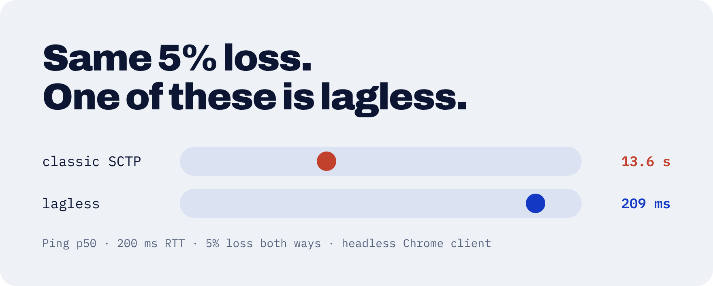

<p align="center">
  <picture>
    <source media="(prefers-color-scheme: dark)" srcset="https://raw.githubusercontent.com/stasadance/lagless/main/docs/assets/logo-dark.svg">
    
  </picture>
</p>

<p align="center">Low-latency WebRTC data channels for io games. Rust core, Node.js API.</p>

<p align="center">
  <a href="https://www.npmjs.com/package/lagless"></a>
  <a href="LICENSE"></a>
</p>

<p align="center">
  <a href="https://stasadance.github.io/lagless/">Website</a> ·
  <a href="https://stasadance.github.io/lagless/docs/">Docs</a> ·
  <a href="https://stasadance.github.io/lagless/docs/benchmarks/">Benchmarks</a>
</p>

<p align="center">
  <picture>
    <source media="(prefers-color-scheme: dark)" srcset="https://raw.githubusercontent.com/stasadance/lagless/main/docs/assets/hero-dark.png">
    
  </picture>
</p>

Browsers talk WebRTC data channels, and on lossy links the server side is where lag spikes come from.
lagless is built so that **stale game state gets dropped, not queued**. Built on
[webrtc-rs `rtc`](https://github.com/webrtc-rs/rtc) (sans-I/O) and [napi-rs](https://napi.rs).

## Features

- **True-queue gate.** Unreliable sends are refused when bytes SCTP hasn't released yet (pending +
  in flight) would exceed 64 KiB. No hidden library buffer, so `send()` returning `false` is honest.
- **Pacer.** Per-peer send budget from the measured delivery rate and queue/RTT growth.
  Reliable sends always go and spend budget first; unreliable fills what the link can actually carry.
- **RACK-TLP** (RFC 8985) in SCTP. Loss is detected by time, not 3 dup SACKs, and a tail loss
  probe fires after ~2·SRTT instead of waiting for a 1 s RTO that collapses cwnd.
  Losses of unreliable chunks that won't be resent don't cut cwnd.
- **Honest pings.** Latency probes bypass the gate and the pacer, so ping measures the real queue.
- **Stats you can act on.** Per-peer queue bytes, cwnd, srtt, min RTT, pacer rate and RACK/RTO counters.
- **TypeScript API** on npm, with prebuilt binaries for Linux x64/arm64 (glibc and musl), macOS x64/arm64 and Windows x64.

## Install

```sh
pnpm add lagless
```

Prebuilt binaries for Linux x64 and arm64 (glibc and musl/Alpine), macOS x64 and arm64, and Windows x64 ship inside
the package, so there's no compile step and no per-platform packages. Node >= 18.

## Usage

```ts
import { Server } from 'lagless';

const server = new Server({ port: 7000 }); // one UDP port for every peer; defaults: unreliableLimit 65536, rack true, pacer true

// signaling is yours: get the browser's offer over HTTP/WebSocket (no need to wait for ICE gathering)
const { peer, answer } = await server.accept(offer, PUBLIC_IP); // or [PUBLIC_IPV4, PUBLIC_IPV6]
// -> send `answer` ({ type, sdp }) back to the browser

server.on('message', ({ peer, label, data }) => handle(peer, label, data));
server.on('channelopen', ({ peer, label }) => { /* can send on `label` now */ });
server.on('close', ({ peer, reason }) => forget(peer)); // 'local' | 'closed' | 'failed'; peer is already removed

function tick() {
  server.send(peer, 'reliable', events);            // reliable: always queued
  for (const snap of snapshots) {
    if (!server.send(peer, 'state', snap)) break;   // unreliable: false = dropped, keep it owed;
  }                                                 // next tick sends fresher absolute state
}
// latency probes: server.send(peer, 'state', pong, { exempt: true }) bypasses gate and pacer
```

Browser side: `pc.createDataChannel('state', { ordered: false, maxRetransmits: 0 })` and
`pc.createDataChannel('reliable')`, wait for ICE gathering to complete, send `pc.localDescription`.

### NAT, firewalls and TURN

The server is ICE-lite with one public host candidate and needs no STUN or TURN of its own.
Behind a NAT (cloud VMs with an elastic/public IP, home servers with a forwarded port),
`await server.publicAddress('stun.example.com:3478')` asks a STUN server from the shared port and
returns `{ ip, port }` to pass to `accept(offer, ip, port)`. The NAT must keep that mapping open
and let inbound UDP through (1:1 NAT or a port forward), same as any UDP game server.
Players behind symmetric NAT or networks that block UDP put a TURN server in the **browser's**
config; the TURN server relays to the server's host candidate over UDP:

```js
new RTCPeerConnection({ iceServers: [
  { urls: ['turn:turn.example.com:3478?transport=udp', 'turns:turn.example.com:443?transport=tcp'],
    username, credential },
] })
```

`turns:` on 443 gets through networks that only allow HTTPS. TCP or TLS to the TURN server adds
head-of-line blocking on that leg, so expect worse latency under loss than direct UDP. The
server must accept UDP from the TURN server's relay IPs. The test suite covers a relay-only
client against coturn.

### API

| | |
|---|---|
| `new Server(opts?)` | `unreliableLimit` (bytes, 0 = off; unreliable is also dropped while SCTP has > 2400 B unsent), `reliableLimit` (bytes queued per peer before it's kicked, default 4 MiB, 0 = off), `overloadMs` (default 1000, 0 = off), `channelPriority` (`{ label: weight }`), `rack`, `pacer`, `rtoMin` (ms, default 1000), `bindAddress` (default `'0.0.0.0'`, `'::'` = dual-stack), `port` (default 0 = any), `pacerStartRate` (B/s, 65536), `pacerMinRate` (B/s, 8192), `pacerBurstMs` (100), `egressRate` (B/s, server-wide cap, off) |
| `localPort` | the UDP port all peers share |
| `publicAddress(stunServer, timeoutMs = 3000)` | async. STUN Binding from the shared port → `Promise<{ ip, port }>` (the NAT's mapping), for `accept()`. `stunServer` is `host[:port]`, port 3478 by default |
| `accept(offer, advertiseIp, advertisePort = 0)` | async. `offer` is `{ type, sdp }` or its JSON, complete or sent before gathering finished (trickle; later client candidates aren't needed); `advertiseIp` is one IP or an array (one host candidate each, IPv4 and/or IPv6). → `Promise<{ peer, answer, localPort, audio? }>`. `advertisePort` 0 = `localPort`. 4th arg `{ audio }`: see Audio below |
| `sendRtp(peer, mid, data)` | a finished RTP packet on an audio m-line from `accepted.audio.send`, SRTP-encrypted and sent at once (no gate, pacer or egress cap). → `boolean`, `false` until `rtpopen`. Throws if the peer is gone, the server doesn't send on `mid`, or `data` < 12 B |
| `on('rtp' \| 'rtpopen', …)` | `{ peer, mid, data }` decrypted RTP (header + payload) from a receive m-line, never RTCP; `{ peer, mid }` DTLS-SRTP up for that m-line |
| `send(peer, label, data, { exempt }?)` | `data` is a string (sent as a WebRTC string) or bytes. → `boolean`. `false` = unreliable dropped (gate, budget or egress cap), or reliable hit `reliableLimit` (peer closed, reason `reliable-overflow`). Throws if the peer is gone, the channel isn't open or `data` exceeds the max message size |
| `on('message', ({ peer, label, data, isString }) => …)` | every inbound message (`isString`: the sender sent a string), all peers (pushed from the native thread, no polling) |
| `on('open' \| 'channelopen' \| 'close' \| 'error' \| 'overload', …)` | `{ peer }` connected; `{ peer, label }` channel open; `{ peer, reason }` peer gone and removed; `PeerError` (`.peer`), only emitted when an `error` listener exists; `{ peer, overloaded }` reliable overload started/ended |
| `budget(peer)` | bytes the pacer allows right now (negative after a reliable burst) |
| `stats(peer)` | `null` once the peer is gone. `connected, closed, stackOutstanding, pendingCmd, dropped, pacedDrops, egressDrops, sentUnreliable, budget, rate, draining, appLimited, srttMs, minRttMs, cwnd, inflight, pending, rackLost, rackProbes, t3Timeouts, sendErrors, overloaded, overloads, audioBytesIn, audioBytesOut, audioPacketsIn, audioPacketsOut`. SCTP fields are 50 ms snapshots; `rate`/`draining`/`appLimited` update every max(100 ms, srtt) |
| `closePeer(peer)`, `close()` | graceful: SCTP ABORT + DTLS close_notify, so the browser notices at once. `close()` also stops the native thread |
| `native` | the raw Rust binding |

Unreliable messages should carry absolute state (full position, not deltas) so any one can be dropped.

Notes:

- **Which channels are gated.** A channel opened with `maxRetransmits` or `maxPacketLifeTime` (any value,
  so `maxRetransmits: 3` too) counts as unreliable: gated and paced. Every other channel is reliable.
- **Reliable overload.** Reliable sends always go and may push the budget negative. An `overload` event
  (and `stats().overloaded`) fires when the budget stayed below zero for `overloadMs`: reliable load alone
  fills the link and unreliable gets nothing. Shed reliable load or kick the peer.
- **Channel priority.** `channelPriority: { pong: 1024 }` switches SCTP to weighted fair queueing
  (RFC 8260): each channel gets a share of the sent bytes in proportion to its weight (128 very-low,
  256 low = default, 512 medium, 1024 high), so a pong jumps a reliable backlog inside SCTP, not just
  the gate. Without it SCTP sends first-come-first-served.
- **Send failures.** A message rtc refuses after `send()` returned `true` emits `error` and bumps
  `stats().sendErrors`.
- **Audio.** `accept(offer, ip, port, { audio: { fmtp?, send: [{ ssrc, mid?, streamId?, trackId? }] } })`
  answers the offer's Opus audio m-lines on the same peer, port and DTLS session (BUNDLE), at the
  payload type the browser offered (`audio.pt`) with `fmtp` (default `minptime=10;useinbandfec=1`).
  Browser sendonly/sendrecv m-lines become receive m-lines (`audio.recv`, `rtp` events). Each `send`
  entry takes a browser recvonly m-line (`mid`, or the next free one in offer order) and puts its SSRC
  in the answer (`a=ssrc:<ssrc> cname:<streamId>`, `msid:<streamId> <trackId>`), so the browser routes
  it without header extensions; recvonly m-lines without one are answered inactive. rtc does SRTCP and
  sender/receiver reports itself (no NACK/TWCC). The server never encodes: `sendRtp` packets must
  carry the slot's SSRC and `audio.pt`. Without `audio`, audio m-lines are rejected and data channels
  work as before.
- **Threading.** `send()` admission is atomic (CAS on the reservation and the budget), but it compares
  against the loop's last snapshot of the SCTP queue, so limits can be off by one loop pass of sends.
  Call a Server from one JS thread.
- **Logging.** Silent by default. Set `LAGLESS_LOG` (env_logger filter syntax, e.g. `LAGLESS_LOG=debug`)
  to print native logs to stderr. Browsers' mDNS `.local` host candidates are ignored, not resolved;
  the ICE-lite server learns the real address from the browser's checks (peer-reflexive).

## Results

Headless Chromium client, 200 ms RTT, 5% random loss both ways, 40 KB/s offered
(27 KB/s unreliable state + 12 KB/s reliable), worse of 2 seeds, same harness and tick order
(reliable first) for every row. Ping rides the unreliable channel.

**Only server → client is lagless.** Client → server (the ping's outbound leg and anything the
browser sends) is Chrome's own SCTP (dcSCTP) in every row; no server library can change that.

| 5% loss | ping p50 / p95 | state age p50 / p95 | reliable age p50 / p95 |
|---|---|---|---|
| node-datachannel 0.33.6 | 12.6 s / 18.4 s | 11.9 s / 18.3 s | 3.4 s / 4.0 s |
| node-datachannel + 64 KiB buf + drop gate | 3.8 s / 6.8 s | 3.6 s / 6.7 s | 4.0 s / 4.9 s |
| **lagless** (gate + RACK + pacer) | **214 ms / 341 ms** | **160 ms / 293 ms** | **441 ms / 821 ms** |

The node-datachannel gate row uses a verified 64 KiB SCTP send buffer: `sendBufferSize` alone is
silently raised to 256 KiB by libdatachannel, so the bench also sets `maxMessageSize` (details in
[`bench/`](bench/)). Bandwidth caps with bufferbloat, 8 peers on one link, bursty loss, jitter,
RTT swings and 400 ms RTT are in [`bench/results/04-scenarios.md`](bench/results/04-scenarios.md).
The pacer runs the link slightly under capacity to keep the queue near zero.

## Build

```sh
pnpm install
pnpm build        # native module (napi) + TypeScript wrapper (dist/)
pnpm typecheck    # lib, tests and bench
pnpm test         # loopback e2e + 50-peer load test against node-datachannel
pnpm test:soak    # memory/thread leak soak with peer churn (SOAK_SECONDS, SOAK_PEERS)
pnpm test:rust    # pacer unit tests
```

### rtc fork

The WebRTC stack is [stasadance/rtc](https://github.com/stasadance/rtc/tree/lagless), branch `lagless`:
upstream [webrtc-rs/rtc](https://github.com/webrtc-rs/rtc) v0.21.1 (`0fbcaa7`, still upstream `master`) plus the
commits below. The RACK, cwnd and stats commits were later cleaned up into upstream-ready form (rustfmt/clippy
clean, RTO min capped at 60 s, `TransportStats` non-exhaustive, a stats test, CHANGELOG) and that tree is now the
branch head. Its rtc-sctp tests (215) run there: `cargo test -p rtc-sctp`.

| commit | what |
|---|---|
| 1 | rtc-sctp tests bind IPv4 loopback (CI containers without IPv6) |
| 2 | RACK-TLP loss detection (RFC 8985) in rtc-sctp, behind `TransportConfig::with_rack` / `SettingEngine::with_sctp_rack`; configurable RTO min |
| 3 | RACK: losses of chunks that will not be retransmitted (unreliable, retries or lifetime exhausted) do not cut cwnd |
| 4 | `Association::transport_stats()` / `RTCPeerConnection::sctp_transport_stats()`: srtt, min RTT, cwnd, in-flight/pending/acked bytes, RACK and T3 counters |
| 5 | `RTCPeerConnection::add_track_to_transceiver`: attach a send track to one chosen m-line (an answerer's `add_track` takes the first free one, e.g. the mic) |
| 6 | local ICE candidates go on the first accepted m-line, not a rejected (port 0) one, so an answer that rejects leading audio m-lines still connects |

## Release

Run the `release` workflow by hand on `main` (Actions > release > Run workflow). The version is
`YY.M.N` (UTC), where `N` is the number of commits on `main` since the month started (e.g. `26.11.12`).
It builds all seven targets, puts every binary in the one `lagless` package, publishes it to npm with
[trusted publishing](https://docs.npmjs.com/trusted-publishers) (no token), then tags the commit
`v<version>` and creates the GitHub release. The version is stamped at publish time; `package.json`
on `main` is not bumped.

## License

MIT. The `rtc` dependency is MIT OR Apache-2.0 (upstream).
